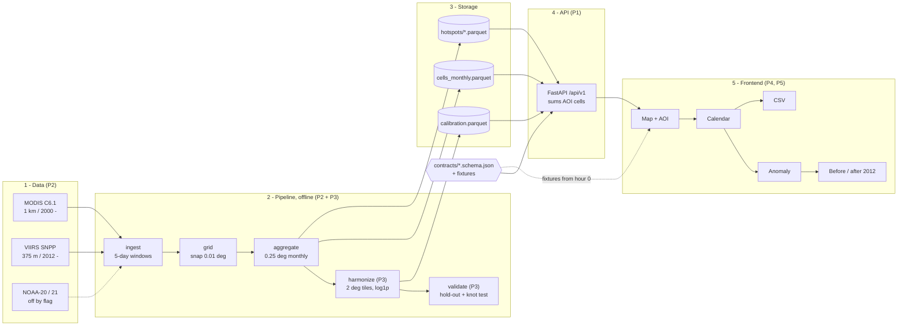

# Architecture

**Diagram:** [`architecture.excalidraw`](architecture.excalidraw) - 117 elements, layers left to right, border colour = module owner. English text, pure ASCII, so it cannot be mangled by any editor or clipboard round-trip.

## Getting it into the Excalidraw room

A live collab room cannot be edited from outside (the encryption key lives in the link), so the file is imported in 15 seconds:

1. Open https://excalidraw.com in a blank tab (**not** the room).
2. `Menu -> Open` -> pick `docs/architecture.excalidraw`.
3. `Ctrl+A`, `Ctrl+C`.
4. Switch to the room tab -> `Ctrl+V`.

It pastes as one block and overwrites nothing. Every box and arrow stays editable.

---

## Layers

## The principle that makes it fast

Heavy work runs once, offline. A request does not read 4M raw points - it sums ~1000 cells from Parquet. Raw points are read only for the CSV export.

Consequence for the team: **P2 and P3 do not block P4.** The frontend runs on `contracts/fixtures/*.json` from hour 0, and the fixtures mirror the real responses field for field.

## Layers and their contracts

| Layer | Input | Output | Owner |
|---|---|---|---|
| Data | FIRMS area API + `MAP_KEY` | `data/raw/**` (CSV, not in git) | P2 |
| Pipeline | `data/raw/**` | `cells_monthly.parquet`, `hotspots/*.parquet`, `calibration.parquet`, `manifest.json` | P2 -> P3 |
| Storage | parquet | same files + schemas in `/contracts` | P1 (schemas), P2 (files) |
| API | parquet + schemas | JSON strictly per `/contracts` | P1 |
| Frontend | JSON / fixtures | 5 UI blocks | P4 (P5: copy, a11y) |

## Storage schema

`cells_monthly.parquet` - one row per (cell, month), already on the unified scale:

| Column | Type | Meaning |
|---|---|---|
| `grid_row`, `grid_col` | int | 0.25 deg cell index from the region's south-west corner |
| `year`, `month` | int | observation month |
| `sensor` | str | sensor behind the unified series: `MODIS`, `VIIRS_SNPP`, ... |
| `hotspot_days` | int | **the product unit**: harmonized count in MODIS scale |
| `hotspot_days_lo`, `hotspot_days_hi` | int | 95% band; equal to `hotspot_days` for MODIS |
| `hotspot_days_raw` | int | sensor-native count, drives the before/after chart |
| `hotspot_days_modis` | int, null | native MODIS count when the month has one; the validation truth |
| `days_observed` | int | how many days of the month actually exist in the data |
| `n_detections` | int | raw detections - diagnostics only, **never** plotted |

`calibration.parquet` - one row per (2 deg tile, month):

| Column | Meaning |
|---|---|
| `tile_row`, `tile_col` | 2 deg tile index |
| `month` | 1-12 |
| `a`, `b` | `log1p(MODIS) = a + b * log1p(VIIRS)` |
| `sigma_a`, `sigma_b` | coefficient errors -> uncertainty band |
| `n_obs` | overlap months used in the fit |
| `shrinkage` | 0..1, weight of the tile fit against the global fit |

`hotspots/*.parquet` - per-year partitions, columns identical to the API CSV: `latitude`, `longitude`, `acq_date`, `acq_time`, `satellite`, `instrument`, `sensor_family`, `confidence`, `frp`, `daynight`, `grid_cell`.

## Four things that must not be spread across layers

1. **The `hotspot_days_1km` unit** is defined in `grid.py` and nowhere else. If the API counts detections while the calendar counts cells, the project fails silently.
2. **`null` is not `0`** in the calendar. A data gap and a real zero are different facts and the UI renders them differently.
3. **`days_observed`** is mandatory in every monthly response. The current month is partial and NRT lags; without this field the anomaly is systematically biased downwards.
4. **Calibration is computed per regional tile, not per AOI.** Otherwise the result depends on what the user drew, and the before/after chart stops being evidence.

## Boundaries and non-goals

- Region is fixed: `bbox = 68.5, 38.4, 80.7, 43.7`. A request outside it returns `422` with a readable message, not a silent zero.
- Global coverage, auth, user uploads, mobile app - not in this iteration.
- In the MVP a polygon is reduced to a list of 0.25 deg cells (centre inside, plus border cells). No rasterisation.

## Deployment

- API: one container (uvicorn), Parquet mounted read-only.
- Frontend: static build (Vite) on any CDN; API URL via `VITE_API_URL`.
- No database. No queue. No runtime background jobs - everything happens in the pipeline.

## API surface

| Endpoint | Purpose |
|---|---|
| `GET /api/v1/aoi/summary` | unified monthly series + coverage |
| `GET /api/v1/aoi/calendar` | year x month matrix for the heatmap |
| `GET /api/v1/aoi/anomaly` | current month vs history (month-to-date) |
| `GET /api/v1/aoi/top` | most active months and years |
| `GET /api/v1/aoi/harmonization` | before/after 2012 + validation metrics |
| `GET /api/v1/aoi/export.csv` | raw hotspots or the monthly table |
| `GET /api/v1/meta/health`, `/meta/region` | diagnostics and region metadata |

Field-by-field reference: [`api-contract.md`](api-contract.md). Machine schemas: [`../contracts/`](../contracts).