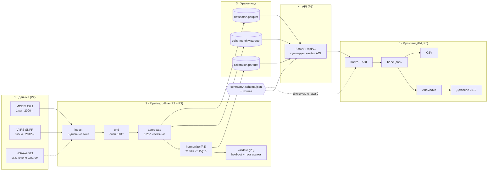

# Архитектура

**Диаграмма:** [`architecture.excalidraw`](architecture.excalidraw) — 117 элементов, слои слева направо, цвет рамки = владелец модуля.

## Как положить её в вашу комнату Excalidraw

Живую коллаб-комнату снаружи не отредактировать (там ключ шифрования в ссылке), поэтому файл импортируется за 15 секунд:

1. Открыть https://excalidraw.com (новая пустая вкладка, **не** комната).
2. `Menu → Open` → выбрать `docs/architecture.excalidraw`.
3. `Ctrl+A` → `Ctrl+C`.
4. Перейти во вкладку с комнатой `#room=5fb1be6a…` → `Ctrl+V`.

Сцена вставится одним блоком, ничего не перезапишет. Дальше её можно двигать и подписывать руками — это обычные прямоугольники и стрелки, не картинка.

---

## Слои

## Принцип, на котором держится скорость

Тяжёлое считается заранее, один раз, офлайн. На запрос API не читает 4 млн точек — он суммирует ~1000 ячеек из Parquet. Сырые точки читаются только для CSV.

Следствие для ролей: **P2 и P3 не блокируют P4**. Фронт с первого часа живёт на `contracts/fixtures/*.json`, которые повторяют форму реальных ответов до последнего поля.

## Слои и их контракты

| Слой | Вход | Выход | Владелец |
|---|---|---|---|
| Данные | FIRMS area API + `MAP_KEY` | `data/raw/**` (CSV, не в git) | P2 |
| Pipeline | `data/raw/**` | `cells_monthly.parquet`, `hotspots/*.parquet`, `calibration.parquet`, `manifest.json` | P2 → P3 |
| Хранилище | parquet | те же файлы + схемы в `/contracts` | P1 (схемы), P2 (файлы) |
| API | parquet + схемы | JSON строго по `/contracts` | P1 |
| Фронтенд | JSON / фикстуры | 5 блоков UI | P4 (P5 — тексты, a11y) |

## Схема хранения

`cells_monthly.parquet` — одна строка на (ячейка, месяц, семейство сенсора):

| Колонка | Тип | Смысл |
|---|---|---|
| `grid_row`, `grid_col` | int | индекс ячейки 0.25°, от юго-западного угла региона |
| `year`, `month` | int | месяц наблюдения |
| `sensor_family` | str | `MODIS` · `VIIRS_SNPP` · `VIIRS_NOAA20` · `VIIRS_NOAA21` |
| `hotspot_days` | int | **единица измерения продукта**: Σ по дням (уникальные 1-км ячейки) |
| `days_observed` | int | сколько дней месяца реально есть в данных |
| `n_detections` | int | сырые детекции — только для диагностики, **не** для графика |

`calibration.parquet` — одна строка на (тайл 2°, месяц):

| Колонка | Смысл |
|---|---|
| `tile_row`, `tile_col` | индекс тайла 2° |
| `month` | 1–12 |
| `a`, `b` | коэффициенты `log1p(MODIS) = a + b·log1p(VIIRS)` |
| `sigma_a`, `sigma_b` | ошибки коэффициентов → интервал неопределённости |
| `n_obs` | сколько месяцев перекрытия попало в подгонку |
| `shrinkage` | 0…1, вес тайловой подгонки против глобальной |

`hotspots/*.parquet` — партиции по году, колонки как в API-CSV: `latitude`, `longitude`, `acq_date`, `acq_time`, `satellite`, `instrument`, `sensor_family`, `confidence`, `frp`, `daynight`, `grid_cell`.

## Четыре вещи, которые нельзя размазывать по слоям

1. **Единица `hotspot_days_1km`** определяется в `grid.py` и больше нигде не переопределяется. Если API начнёт считать «детекции», а календарь — «ячейки», проект развалится тихо.
2. **`null` ≠ `0`** в календаре. Пробел в данных и настоящий ноль — разные вещи, и фронт это рисует по-разному.
3. **`days_observed`** обязателен в каждом месячном ответе. Текущий месяц неполный, NRT догоняет; без этого поля аномалия систематически врёт вниз.
4. **Калибровка считается по региональным тайлам, а не по AOI.** Иначе результат зависит от того, что пользователь нарисовал, и график «до/после» перестаёт быть доказательством.

## Границы и не-цели

- Регион фиксирован: `bbox = 68.5, 38.4, 80.7, 43.7`. Запрос вне региона — `422` с внятным текстом, а не тихий ноль.
- Глобальный охват, авторизация, загрузка своих данных, мобильное приложение — не в этой итерации.
- Полигон в MVP приводится к списку 0.25° ячеек (центр внутри полигона + пограничные partial). Растеризация в растр не нужна.

## Деплой

- API: один контейнер (uvicorn), Parquet монтируется read-only.
- Фронт: статика (Vite build) на любом CDN; API-URL через `VITE_API_URL`.
- Нет базы данных. Нет очередей. Нет фоновых задач в рантайме — всё в pipeline.
